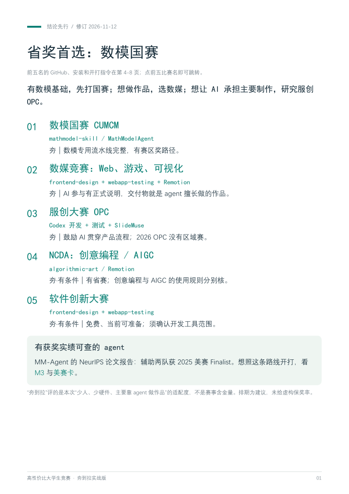
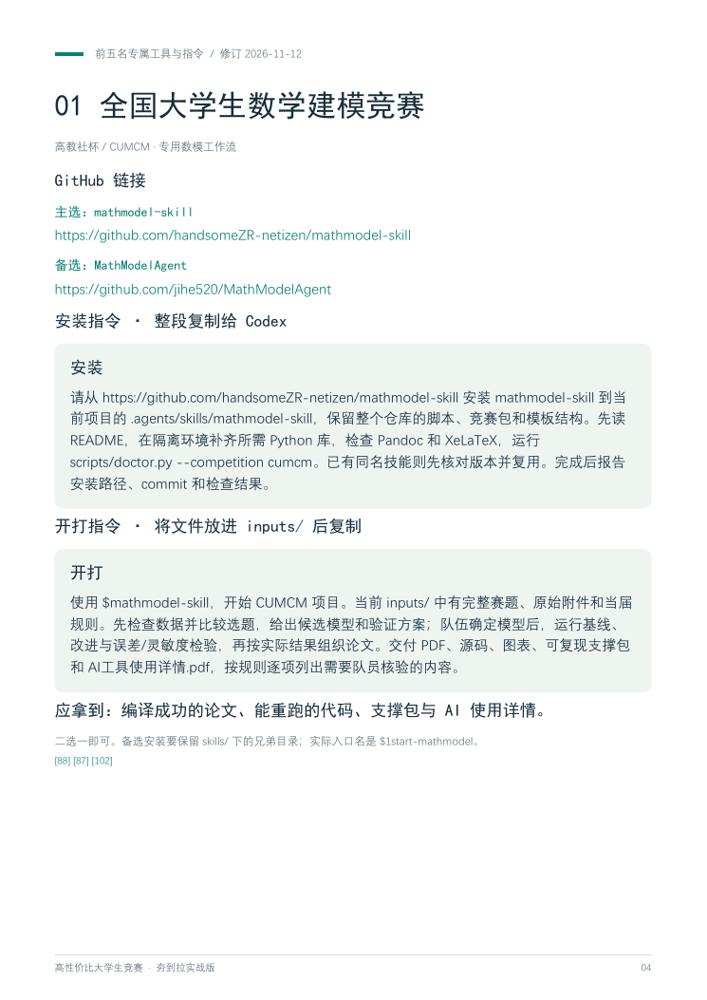

# 高性价比大学生竞赛指南

**选比赛 → 找工具 → 复制指令 → 做出作品。**

📖 **[在线预览 PDF](guide.pdf)**　｜　⬇️ **[下载完整 PDF · 43 页](https://github.com/Rain-dust/HowToCompeteBetter/raw/refs/heads/main/guide.pdf)**　｜　🚀 **[前五名直接开打](#quick-start)**

## 从夯到拉，先看这张表

> 按“主要用 agent 做作品”的适配度排序。括号里的方向很关键；排名不等于赛事含金量或获奖概率。

| 档位 | 比赛（同档按优先顺序） |
| :---: | --- |
| 🔥 **夯**<br>优先考虑 | **[1. 全国大学生数学建模竞赛](#top1)**；**[2. 全国大学生数字媒体科技作品及创意竞赛（Web、游戏、可视化方向）](#top2)**；**[3. 中国大学生服务外包创新创业大赛（OPC创客类）](#top3)**；**[4. 未来设计师·全国高校数字艺术设计大赛（创意编程、AIGC方向）](#top4)**；**[5. 全国大学生软件创新大赛](#top5)** |
| 💪 **强**<br>次选 | 全球校园人工智能算法精英大赛（智能体互联主题赛）；MathorCup数学应用挑战赛；“中国软件杯”大学生软件设计大赛；“中国电机工程学会杯”全国大学生电工数学建模竞赛；中国高校计算机大赛—人工智能创意赛；华为ICT大赛（创新赛）；中国高校智能机器人创意大赛（AIGC方向）；“泰迪杯”数据挖掘挑战赛 |
| 🧩 **中**<br>有额外门槛 | 先进机器人及仿真技术大赛；睿抗机器人开发者大赛；全国大学生电子商务“创新、创意及创业”挑战赛；中国国际大学生创新大赛；“挑战杯”全国大学生课外学术科技作品竞赛；“挑战杯”中国大学生创业计划竞赛；全国大学生市场调查与分析大赛 |
| ⬇️ **拉**<br>Codex 直出适配低 | 中国大学生计算机设计大赛；全国大学生统计建模大赛；全国大学生能源经济学术创意大赛 |

## PDF 预览与下载

**[📖 打开完整 PDF](guide.pdf)　｜　[⬇️ 下载到本地](https://github.com/Rain-dust/HowToCompeteBetter/raw/refs/heads/main/guide.pdf)**

前 3 页看结论，第 4–8 页拿前五名工具与指令。点击下图打开 PDF。

| 排名速览 · 第 1 页 | 工具与指令卡 · 第 4 页 |
| :---: | :---: |
| [](guide.pdf) | [](guide.pdf) |

<a id="quick-start"></a>

## 前五名：工具链接和开打指令

**把赛题、附件、当届规则和评分标准放进项目的 `inputs/`。** 首次使用先展开安装指令；安装完成后，复制开打指令给 Codex。

数模使用专用工作流；其余四项使用现成开发、测试和展示工具组合。

<a id="top1"></a>

### 01 全国大学生数学建模竞赛

高教社杯 / CUMCM；有数模基础优先考虑。

**GitHub：** [主选：mathmodel-skill](https://github.com/handsomeZR-netizen/mathmodel-skill) · [备选：MathModelAgent](https://github.com/jihe520/MathModelAgent)

**复制给 Codex：**

```text
使用 $mathmodel-skill，开始 CUMCM 项目。当前 inputs/ 中有完整赛题、原始附件和当届规则。先检查数据并比较选题，给出候选模型和验证方案；队伍确定模型后，运行基线、改进与误差/灵敏度检验，再按实际结果组织论文。交付 PDF、源码、图表、可复现支撑包和 AI工具使用详情.pdf，按规则逐项列出需要队员核验的内容。
```

**交付物：** 编译成功的论文、能重跑的代码、支撑包与 AI 使用详情。

<details>
<summary>首次使用：展开安装指令，复制给 Codex</summary>

```text
请从 https://github.com/handsomeZR-netizen/mathmodel-skill 安装 mathmodel-skill 到当前项目的 .agents/skills/mathmodel-skill，保留整个仓库的脚本、竞赛包和模板结构。先读 README，在隔离环境补齐所需 Python 库，检查 Pandoc 和 XeLaTeX，运行 scripts/doctor.py --competition cumcm。已有同名技能则先核对版本并复用。完成后报告安装路径、commit 和检查结果。
```

</details>

备选 MathModelAgent 的入口是 `$1start-mathmodel`，安装时保留 `skills/` 下的兄弟目录；完整步骤见[前五名指令页](docs/top5-start.md)。

---

<a id="top2"></a>

### 02 全国大学生数字媒体科技作品及创意竞赛

优先 Web、游戏、可视化作品方向。

**GitHub：** [开发界面与测试：Anthropic Skills](https://github.com/anthropics/skills) · [视频与代码动画：Remotion Skills](https://github.com/remotion-dev/skills)

**复制给 Codex：**

```text
我要参加全国大学生数字媒体科技作品及创意竞赛，选 Web/游戏/可视化作品方向。当届规则、评分标准与我的选题在 inputs/。先核参赛类别并比较 3 个可交付方案，再选一个只含单一核心交互的方案实施。用 $frontend-design 完成作品，$webapp-testing 测主流程和异常输入；用 $remotion-best-practices 制作演示。交付可运行作品、源码、测试截图、视频、说明与 AI 工具使用说明。
```

**交付物：** 可运行作品＋浏览器验收证据＋视频＋创作与 AI 过程说明。

<details>
<summary>首次使用：展开安装指令，复制给 Codex</summary>

```text
请从 https://github.com/anthropics/skills 安装 skills/frontend-design 和 skills/webapp-testing 的完整目录到当前项目 .agents/skills，并配置 Playwright 及其浏览器。再从 https://github.com/remotion-dev/skills 按 README 为当前 Codex 安装 remotion-best-practices 及必需资源；检查 Node.js 和渲染环境。已有技能则复用。完成一次最小网页测试和短视频渲染，报告路径、commit 与实际产物。
```

</details>

主体开发由 Codex 完成；先确认当届参赛类别和素材授权。

---

<a id="top3"></a>

### 03 中国大学生服务外包创新创业大赛

优先 OPC 创客类；2026 OPC 不走区域赛。

**GitHub：** [开发与浏览器验收：Anthropic Skills](https://github.com/anthropics/skills) · [答辩与可编辑 PPT：SlideMuse](https://github.com/helloo1568/slidemuse)

**复制给 Codex：**

```text
我要参加中国大学生服务外包创新创业大赛 OPC 创客类。inputs/ 有当届手册、评分要求和我的真实需求/用户资料。先做要求、功能、测试、演示对应表；用 $frontend-design 和 Codex 实现一个完整小产品，再用 $webapp-testing 验收并部署。根据真实试用反馈迭代，生成产品报告和演示脚本；最后用 $slidemuse 做答辩 PPT。缺失的用户或运营数据列为待补，保留开发与 AI 使用记录。
```

**交付物：** 可用产品＋实际试用记录＋产品报告＋演示与 PPT。

<details>
<summary>首次使用：展开安装指令，复制给 Codex</summary>

```text
请从 https://github.com/anthropics/skills 安装 skills/frontend-design 和 skills/webapp-testing 完整目录到当前项目 .agents/skills，配置 Playwright 浏览器测试。再读取 https://github.com/helloo1568/slidemuse 的 README，按 install.py --client codex 的当前用法安装并自检；使用隔离依赖，已有技能则复用。核对图像生成与 PPTX 导出条件，报告安装路径、commit 和最小验收结果。
```

</details>

用户反馈、运营数据须来自实际试用；这里使用的是通用工具组合。

---

<a id="top4"></a>

### 04 未来设计师·全国高校数字艺术设计大赛

优先创意编程；AIGC 类需单独核对规则。

**GitHub：** [交互与视觉创作：Anthropic Skills](https://github.com/anthropics/skills) · [视频/动态作品：Remotion Skills](https://github.com/remotion-dev/skills)

**复制给 Codex：**

```text
我要参加未来设计师·全国高校数字艺术设计大赛 NCDA。inputs/ 有当届目标类别细则、评分要求、主题和素材。先核创意编程与 AIGC 类各自要求，再选择合适类别。用 $algorithmic-art 比较 3 个原创交互机制，确定后输出 HTML/JS；用 $frontend-design 打磨界面、$webapp-testing 验收。需要动态展示时用 $remotion-best-practices。交付程序包、实际运行视频、海报、设计说明和创作过程，逐项对照当届格式。
```

**交付物：** 可交互程序＋实际运行视频＋海报＋设计过程。

<details>
<summary>首次使用：展开安装指令，复制给 Codex</summary>

```text
请从 https://github.com/anthropics/skills 将 skills/algorithmic-art、skills/frontend-design、skills/webapp-testing 的完整目录安装到当前项目 .agents/skills；检查 p5.js、浏览器和 Playwright。再从 https://github.com/remotion-dev/skills 按 README 安装 remotion-best-practices 及必要资源。已有技能复用。用一个最小交互作品和一次短视频渲染验收，报告安装路径、commit 与产物。
```

</details>

创意编程（含游戏）与 AIGC 的类别规则分开核对。

---

<a id="top5"></a>

### 05 全国大学生软件创新大赛

从当届指定赛题中选，先核外部 AI 工具权限。

**GitHub：** [界面实现与验收：Anthropic Skills](https://github.com/anthropics/skills) · [答辩演示：SlideMuse](https://github.com/helloo1568/slidemuse)

**复制给 Codex：**

```text
我要参加全国大学生软件创新大赛。inputs/ 有当届指定赛题、评分标准、工具条款和素材。先核外部 AI 编程工具权限；逐条建立评分要求、功能、测试与演示对应表。由 Codex 完成前后端和核心逻辑，用 $frontend-design 打磨界面、$webapp-testing 验收所有评分动作和异常输入。先交一个稳定的端到端版本，再补效果对照和文档。最后用 $slidemuse 做答辩，交付源码、启动/部署说明、测试证据与演示视频。
```

**交付物：** 完整软件＋可复现部署＋评分覆盖测试＋答辩材料。

<details>
<summary>首次使用：展开安装指令，复制给 Codex</summary>

```text
请从 https://github.com/anthropics/skills 安装 skills/frontend-design 和 skills/webapp-testing 完整目录到当前项目 .agents/skills，配置 Playwright 及浏览器。再按 https://github.com/helloo1568/slidemuse 的 README 使用 install.py --client codex 安装并自检，依赖放隔离环境，已有技能复用。检查该题规定的终端、SDK 和开发环境，运行最小界面测试与 PPT 导出，报告路径、commit 和结果。
```

</details>

题目要求原生移动端时使用对应技术栈；`webapp-testing` 只覆盖 Web 部分。

---

## 详细资料

📚 [67 条选赛资料](docs/competition-catalog.md) · 🧰 [前五名完整安装与开打指令](docs/top5-start.md) · 🔗 [来源索引](docs/sources.md) · 🗂️ [JSON 数据](data/) · 🐦 [推文文案](social/x-post.txt)

含 67 条选赛资料（包括分支、平台和同一赛事的省级入口）、11 组工具；67 条并非 67 项独立竞赛。

<details>
<summary>排名口径、AI 规则与资料日期</summary>

排名综合已有工具、硬件与交付成本、能力复用和奖项路径；适合用来筛选方向。

国赛 2026 允许 agent 辅助，核心建模与分析由参赛队主导和核验；4C 计算机设计有 AI 工具名单；统计建模和能源经济对直接生成核心内容另有限制。细则见 PDF 和各条来源。

全国性赛事、国家级/省级证书、校内 A/B/C 是三个口径。教育部没有本项目可套用的全国统一 ABC 分类，加分前查本校当届认定。

**修订：2026-11-12。** 赛事规则检索截至 2026-11-10；前五工具链接和安装文档于 2026-11-12 复核，当届主办方新通知优先。

MM-Agent 的 NeurIPS 2025 论文报告辅助两支队伍获 2025 美赛 Finalist；原系统和后来发布的 Codex 技能包分别说明。本资料核对了公开说明、关键技能文件和配套资源，未将静态核查写成端到端实测。

第三方工具只链接原仓库，其许可按各仓库处理。

</details>

结构与命名灵感来自 [高性价比人生指南 · HowToLiveBetter](https://github.com/eternity4719/HowToLiveBetter)。本项目赛事分析重新研究撰写。
