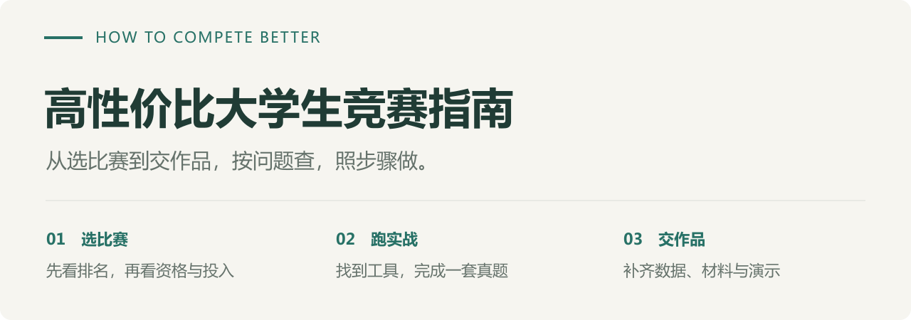
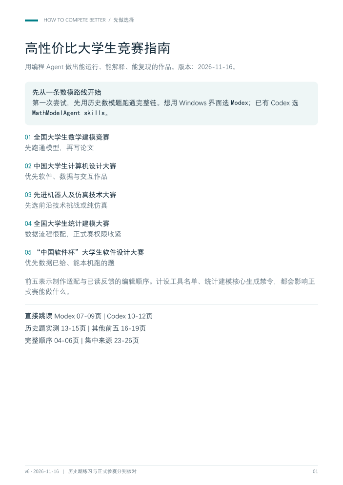

# 高性价比大学生竞赛指南

## [打开在线阅读与搜索 ↗](https://rain-dust.github.io/HowToCompeteBetter/)

首页直接看排名、前五Agent与GitHub，复制开打指令；也可搜全文、按条件找比赛，手机直接打开。

哪些比赛值得打，用什么 Agent，拿到赛题后怎样开始？ 
把选赛、工具、数模实战和作品交付，写成可以按问题查的十章指南。

**27项连续参考排名 · 73条赛事参考 · 完整数模教程与复现案例**

### [从目录开始](#目录) · [直接做数模](book/04-用Codex完成数模.md) · [预览 PDF](guide.pdf)

<table>
<tr><td width="64" align="right"><b>在线</b></td><td align="left">

[阅读指南](https://rain-dust.github.io/HowToCompeteBetter/) · [比赛筛选](https://rain-dust.github.io/HowToCompeteBetter/#/contests) · [全文搜索](https://rain-dust.github.io/HowToCompeteBetter/#/search)

</td></tr>
<tr><td width="64" align="right"><b>下载</b></td><td align="left">

[PDF 预览](guide.pdf) · [PDF 下载](https://github.com/Rain-dust/HowToCompeteBetter/raw/refs/heads/main/guide.pdf) · [离线筛选 HTML](https://github.com/Rain-dust/HowToCompeteBetter/releases/latest/download/explorer.html) · [开赛模板 ZIP](templates/contest-starter.zip)

</td></tr>
<tr><td width="64" align="right"><b>查阅</b></td><td align="left">

[全书目录](book/README.md) · [1–27 排名](book/02-看懂排名与奖项.md#ranking) · [全部赛事卡](docs/competition-catalog.md) · [资料与核查](docs/research/README.md)

</td></tr>
<tr><td width="64" align="right"><b>实战</b></td><td align="left">

[Modex 官方教程](docs/modex.md) · [Codex 安装开跑](docs/coding-agent.md) · [国赛 B 题成果](examples/cumcm2024b/README.md) · [零依赖小样例](templates/contest-starter-example/README.md)

</td></tr>
<tr><td width="64" align="right"><b>反馈</b></td><td align="left">

[参赛者怎么说](docs/field-feedback.md) · [提交参赛经历](https://github.com/Rain-dust/HowToCompeteBetter/issues/new?template=experience.yml) · [纠错补充](https://github.com/Rain-dust/HowToCompeteBetter/issues/new?template=correction.yml)

</td></tr></table>

离线筛选页下载后用浏览器打开。赛事参考含赛项和平台；报名时以具体届次、组别和学校认定为准。

---

## 这本指南回答什么

| 你的问题 | 去哪看 |
| --- | --- |
| 还没选比赛，怎样先缩小范围？ | [1. 先选值得打的比赛](book/01-先选值得打的比赛.md) |
| 排在前面就能报名、拿省奖吗？ | [2. 看懂排名与奖项](book/02-看懂排名与奖项.md) |
| 想直接给赛题、用桌面软件跑全流程，怎么配？ | [3. 用Modex完成数模](book/03-用Modex完成数模.md) |
| 已经在用 Codex 或 Claude Code，装哪套技能、怎么开跑？ | [4. 用Codex完成数模](book/04-用Codex完成数模.md) |
| Agent 到底产出了什么，结果能重新算出来吗？ | [5. 从真题看完整成果](book/05-从真题看完整成果.md) |
| 计设、软件杯这类作品赛，怎么交给 Agent 推进？ | [6. 软件与设计作品怎么做](book/06-软件与设计作品怎么做.md) |
| RST 该选创新作品还是仿真，怎么开始？ | [7. 仿真与机器人怎么做](book/07-仿真与机器人怎么做.md) |
| 没有数据、没有材料，怎么做出可核对的成果？ | [8. 数据、论文与项目材料](book/08-数据、论文与项目材料.md) |
| 项目跑通之后，还差什么才能交？ | [9. 演示、答辩与提交](book/09-演示、答辩与提交.md) |
| 排名用了谁的经历，哪些结论还不确定？ | [10. 真实反馈与资料核查](book/10-真实反馈与资料核查.md) |

## 怎么读

- **还没选比赛**：从[1. 先选值得打的比赛](book/01-先选值得打的比赛.md)开始，挑出两三项，再读[2. 看懂排名与奖项](book/02-看懂排名与奖项.md)核资格、奖项和学校认定。
- **现在就想跑数模**：现成软件看[3. 用Modex完成数模](book/03-用Modex完成数模.md)；已有 Codex 看[4. 用Codex完成数模](book/04-用Codex完成数模.md)。运行结果和复现材料在[5. 从真题看完整成果](book/05-从真题看完整成果.md)。
- **已有想法或项目**：软件作品看[6. 软件与设计作品怎么做](book/06-软件与设计作品怎么做.md)，仿真项目看[7. 仿真与机器人怎么做](book/07-仿真与机器人怎么做.md)，最后按第8、9章补数据、材料和演示。

排名反映 Agent 制作适配，正式参赛建议另列。计设的外部 Codex 许可待核，统计建模的正式赛核心生成受限；具体结论和原文在对应赛事卡。

## 目录

**[1. 先选值得打的比赛](book/01-先选值得打的比赛.md)**

[报名前先过三关](book/01-先选值得打的比赛.md#s01) · [组队先试做，别只看简历](book/01-先选值得打的比赛.md#s03)

**[2. 看懂排名与奖项](book/02-看懂排名与奖项.md)**

[连续制作参考顺序 1–27](book/02-看懂排名与奖项.md#ranking) · [验证状态如何理解](book/02-看懂排名与奖项.md#s04)

**[3. 用Modex完成数模](book/03-用Modex完成数模.md)**

[下载、安装与首次打开](book/03-用Modex完成数模.md#s02) · [新建任务并输入赛题](book/03-用Modex完成数模.md#s05) · [编译、编辑与导出](book/03-用Modex完成数模.md#s08)

**[4. 用Codex完成数模](book/04-用Codex完成数模.md)**

[创建工作区](book/04-用Codex完成数模.md#s02) · [一次启动完整链](book/04-用Codex完成数模.md#s04) · [中断后继续](book/04-用Codex完成数模.md#s07)

**[5. 从真题看完整成果](book/05-从真题看完整成果.md)**

[快速核对结果](book/05-从真题看完整成果.md#s02) · [复现计算](book/05-从真题看完整成果.md#s03) · [验收证据](book/05-从真题看完整成果.md#s05)

**[6. 软件与设计作品怎么做](book/06-软件与设计作品怎么做.md)**

[计设：工具与完整启动任务](book/06-软件与设计作品怎么做.md#s02) · [软件杯：工具与完整启动任务](book/06-软件与设计作品怎么做.md#s03)

**[7. 仿真与机器人怎么做](book/07-仿真与机器人怎么做.md)**

[先确认你的 RST 属于哪一种评审](book/07-仿真与机器人怎么做.md#s01) · [工具与完整启动任务](book/07-仿真与机器人怎么做.md#s02) · [把基线、改动与失败留在同一套环境里](book/07-仿真与机器人怎么做.md#s03)

**[8. 数据、论文与项目材料](book/08-数据、论文与项目材料.md)**

[第一次做完整项目：先跑零依赖小样例](book/08-数据、论文与项目材料.md#practice) · [数据给 Agent 前，至少保留这几列](book/08-数据、论文与项目材料.md#s01) · [先有计算结果，再写论文与项目材料](book/08-数据、论文与项目材料.md#paper)

**[9. 演示、答辩与提交](book/09-演示、答辩与提交.md)**

[每个评分点，都有一件能拿出来的证据](book/09-演示、答辩与提交.md#s01) · [路演先搭七个问题](book/09-演示、答辩与提交.md#s03) · [让 Agent 做一次“挑错评委”](book/09-演示、答辩与提交.md#s04)

**[10. 真实反馈与资料核查](book/10-真实反馈与资料核查.md)**

[这批反馈读了什么，没有统计什么](book/10-真实反馈与资料核查.md#s01) · [把作者亲历、外部自述与工具实跑分开](book/10-真实反馈与资料核查.md#s03) · [报名时重新核规则，发现错误直接补证据](book/10-真实反馈与资料核查.md#s04)

[展开57节完整目录](book/README.md) · [按条件找比赛](docs/competition-catalog.md) · [查看27项连续排名](book/02-看懂排名与奖项.md#ranking)

## 前五：工具与开打指令

先看当届建议，再复制对应指令。每项的 GitHub、安装和启动写在一起。

这些任务默认你已在 Agent 中打开本仓库。第一次使用，先按[第4章创建工作区](book/04-用Codex完成数模.md#s02)，再把题面、规则和附件放进 `inputs/`。

| 参考序号 / 比赛 | GitHub 与当届建议 |
| --- | --- |
| **1. [全国大学生数学建模竞赛（高教社杯/CUMCM）](docs/contests/N22.md)** | [N-allpass/modex-mh-agent](https://github.com/N-allpass/modex-mh-agent) · [jihe520/MathModelAgent](https://github.com/jihe520/MathModelAgent) 先练习；正式赛仅辅助 |
| **2. [中国大学生计算机设计大赛（4C）](docs/contests/N38.md)** | [anthropics/skills](https://github.com/anthropics/skills) 外部Codex许可待核 |
| **3. [先进机器人及仿真技术大赛（RST）](docs/contests/N18.md)** | [anthropics/skills](https://github.com/anthropics/skills) 先定赛项，再跑官方基线 |
| **4. [全国大学生统计建模大赛](docs/contests/N23.md)** | [K-Dense-AI/scientific-agent-skills](https://github.com/K-Dense-AI/scientific-agent-skills) 正式赛核心生成受限 |
| **5. [“中国软件杯”大学生软件设计大赛](docs/contests/N02.md)** | [anthropics/skills](https://github.com/anthropics/skills) 纯软件题可研究；先核工具 |

<strong>1. 全国大学生数学建模竞赛（高教社杯/CUMCM）：展开安装与开打</strong>

**先练习；正式赛仅辅助。** [赛事详情](docs/contests/N22.md)

[Modex官方展示仓库](https://github.com/N-allpass/modex-mh-agent) · [MathModelAgent主选技能链](https://github.com/jihe520/MathModelAgent)

[Codex 完整安装步骤](docs/coding-agent.md) · [Modex 官方配置教程](docs/modex.md)

**复制给 Agent：安装**

~~~text
先读 docs/math-modeling.md。Modex按官网和官方手册安装配置；Codex/Claude用本仓库 scripts/setup_math_workspace.py 建独立工作区，固定上游commit 03f4eb388b3862b7bde55b508dceaf3d6b39d5ac，安装完整兄弟技能、资源与Typst；运行脚本预检后再开模型。
~~~

**复制给 Agent：开打**

~~~text
使用 $1start-mathmodel，完整处理 inputs/problem.pdf 与全部附件。偏好已给：Typst、国赛中文、问数按题面，不重复确认。连续完成建模、实际计算、图表、论文和验收；所有数字来自真实运行，缺失样本不伪造。完整重跑并编译PDF、逐页查看，交付代码、结果、图表、paper/main.pdf与验收清单。
~~~

<strong>2. 中国大学生计算机设计大赛（4C）：展开安装与开打</strong>

**外部Codex许可待核。** [赛事详情](docs/contests/N38.md)

[界面与浏览器测试技能](https://github.com/anthropics/skills) · [可选视频制作](https://github.com/remotion-dev/skills)

**复制给 Agent：安装**

~~~text
请从 https://github.com/anthropics/skills 将 skills/frontend-design 和 skills/webapp-testing 两个完整目录安装到当前项目 .agents/skills/。保留脚本和资源，按 SKILL.md 建隔离依赖并配置 Playwright 浏览器。已有技能先核对并复用。用最小网页做一次主流程测试，报告安装路径、commit、实际截图与缺失依赖。安装后在此项目重开会话或确认技能已被发现。
~~~

**复制给 Agent：开打**

~~~text
我要做中国大学生计算机设计大赛软件作品。inputs/ 有当届规程、赛道要求和真实需求。先输出工具权限与评分项对照表：2026规程限制AI工具范围，不能默认Codex在名单内。用于赛前练习，或确认当前参赛范围允许后，用 $frontend-design 完成一个单一核心功能的可运行系统；用 $webapp-testing 测正常、空输入和异常场景。交付实际运行视频、源码、部署说明和过程材料；演示必须来自同一版本，别只做PPT。
~~~

<strong>3. 先进机器人及仿真技术大赛（RST）：展开安装与开打</strong>

**先定赛项，再跑官方基线。** [赛事详情](docs/contests/N18.md)

[创新软件作品可用技能](https://github.com/anthropics/skills) · [可替代Codex的独立编程agent：Cline](https://github.com/cline/cline)

**复制给 Agent：安装**

~~~text
先读 inputs/ 的具体RST届次、赛项、平台和SDK。仿真竞技先配置官方环境并运行基线，不预装无关网页技能。只有创新作品确实需要Web界面时，才从 https://github.com/anthropics/skills 完整安装 frontend-design 与 webapp-testing 到项目 .agents/skills/ 并做最小验证。报告实际平台版本、基线成绩、日志和缺失依赖。
~~~

**复制给 Agent：开打**

~~~text
我要参加RST，具体届次、赛道、组别、官方规则和平台SDK已放 inputs/。先识别这是创新创业作品还是仿真竞技，不能混用评审方式。创新作品：完成一个能运行并按评分点演示的小产品；仿真：先跑官方基线、记录多次成绩，再逐项改策略，输出同环境的对照、失败回放和日志。按我的具体组别整理源码、说明、视频与答辩。官方基线未跑通前先修环境，不虚构成绩。
~~~

<strong>4. 全国大学生统计建模大赛：展开安装与开打</strong>

**正式赛核心生成受限。** [赛事详情](docs/contests/N23.md)

[Scientific Agent Skills](https://github.com/K-Dense-AI/scientific-agent-skills) · [统计分析入口](https://github.com/K-Dense-AI/scientific-agent-skills/tree/main/skills/statistical-analysis) · [数据检查入口](https://github.com/K-Dense-AI/scientific-agent-skills/tree/main/skills/exploratory-data-analysis)

**复制给 Agent：安装**

~~~text
请从 https://github.com/K-Dense-AI/scientific-agent-skills 安装 skills/exploratory-data-analysis 与 skills/statistical-analysis 两个完整目录到当前项目 .agents/skills/，连同引用资源一起保留。按各 SKILL.md 配置独立 Python 环境，不安装无关科学栈。用本地合成CSV完成一次有缺失值、重复和分组信息的检查，报告环境、commit与结果。此安装用于赛前练习，不代表获准生成正式参赛核心内容。
~~~

**复制给 Agent：开打**

~~~text
请先读 inputs/ 的全国大学生统计建模大赛当届AI规范。2026正式赛模式只执行规则明确允许的文献检索整理、语言格式校对等环节；不要直接生成研究选题、假设、框架、调查方案或论文正文。把拟执行的数据与代码任务单独列出待核权限。赛前练习模式下，可用 $exploratory-data-analysis 和 $statistical-analysis 对合成/历史练习数据做审计、按已给方案复现与诊断，输出可重跑代码和错误记录。正式提交内容以获准范围和人工原创方案为准。
~~~

<strong>5. “中国软件杯”大学生软件设计大赛：展开安装与开打</strong>

**纯软件题可研究；先核工具。** [赛事详情](docs/contests/N02.md)

[开发与测试技能](https://github.com/anthropics/skills) · [可选演示视频技能](https://github.com/remotion-dev/skills)

**复制给 Agent：安装**

~~~text
请从 https://github.com/anthropics/skills 将 skills/frontend-design 和 skills/webapp-testing 两个完整目录安装到当前项目 .agents/skills/。保留脚本和资源，按 SKILL.md 建隔离依赖并配置 Playwright 浏览器。已有技能先核对并复用。用最小网页做一次主流程测试，报告安装路径、commit、实际截图与缺失依赖。安装后在此项目重开会话或确认技能已被发现。
~~~

**复制给 Agent：开打**

~~~text
我要参加中国软件杯。inputs/ 有当届题目、评分标准、规定技术栈、工具条款与原始数据。先把每个评分点写成可操作验收动作，确认数据、接口和硬件可得，再做最小端到端系统。用 $frontend-design 打磨界面，用 $webapp-testing 验证Web评分动作与异常输入；原生部分另用对应测试工具。先修稳定性再加功能，最后交源码、环境锁定、部署说明、同版本演示视频和答辩问答，保留AI开发记录。
~~~

展开完整的 1–27 连续参考排名

| 序号 | 比赛 | 当届建议 |
| :--: | --- | --- |
| 1 | [全国大学生数学建模竞赛（高教社杯/CUMCM）](docs/contests/N22.md) | 先练习；正式赛仅辅助 |
| 2 | [中国大学生计算机设计大赛（4C）](docs/contests/N38.md) | 外部Codex许可待核 |
| 3 | [先进机器人及仿真技术大赛（RST）](docs/contests/N18.md) | 先定赛项，再跑官方基线 |
| 4 | [全国大学生统计建模大赛](docs/contests/N23.md) | 正式赛核心生成受限 |
| 5 | [“中国软件杯”大学生软件设计大赛](docs/contests/N02.md) | 纯软件题可研究；先核工具 |
| 6 | [美国大学生数学建模竞赛（MCM/ICM）](docs/contests/E06.md) | 允许负责任AI辅助，须披露 |
| 7 | [MathorCup数学应用挑战赛](docs/contests/E02.md) | 核心独立完成，AI仅辅助 |
| 8 | [华中杯大学生数学建模挑战赛](docs/contests/H01.md) | 先核具体赛项与工具范围 |
| 9 | [“中国电机工程学会杯”全国大学生电工数学建模竞赛](docs/contests/E05.md) | 先核具体赛项与工具范围 |
| 10 | [“泰迪杯”数据挖掘挑战赛](docs/contests/E01.md) | 先核具体赛项与工具范围 |
| 11 | [中国大学生服务外包创新创业大赛](docs/contests/N01.md) | 有真实产品需求，再查OPC |
| 12 | [全国大学生数字媒体科技作品及创意竞赛](docs/contests/N10.md) | 先核具体赛项与工具范围 |
| 13 | [未来设计师·全国高校数字艺术设计大赛（NCDA）](docs/contests/N11.md) | 先核具体赛项与工具范围 |
| 14 | [全国大学生软件创新大赛](docs/contests/N03.md) | 先核具体赛项与工具范围 |
| 15 | [全球校园人工智能算法精英大赛](docs/contests/N09.md) | 先核具体赛项与工具范围 |
| 16 | [中国高校计算机大赛-人工智能创意赛](docs/contests/N04.md) | 先核具体赛项与工具范围 |
| 17 | [华为ICT大赛-创新赛](docs/contests/N28.md) | 先核具体赛项与工具范围 |
| 18 | [中国高校智能机器人创意大赛](docs/contests/N15.md) | 先核具体赛项与工具范围 |
| 19 | [睿抗机器人开发者大赛（RAICOM）](docs/contests/N17.md) | 先核具体赛项与工具范围 |
| 20 | [全国大学生电子商务“创新、创意及创业”挑战赛（三创赛）](docs/contests/N20.md) | 已有真实项目再考虑 |
| 21 | [中国国际大学生创新大赛（原“互联网+”）](docs/contests/N30.md) | 已有真实项目再考虑 |
| 22 | [“挑战杯”全国大学生课外学术科技作品竞赛](docs/contests/N31.md) | 已有真实项目再考虑 |
| 23 | [“挑战杯”中国大学生创业计划竞赛](docs/contests/N32.md) | 已有真实项目再考虑 |
| 24 | [全国大学生市场调查与分析大赛（正大杯）](docs/contests/N21.md) | 核心由人完成，辅助范围另核 |
| 25 | [全国大学生能源经济学术创意大赛](docs/contests/N24.md) | 不适合AI自动生成作品参赛 |
| 26 | [“华数杯”大学生数学建模竞赛](docs/contests/E03.md) | 先核具体赛项与工具范围 |
| 27 | [华为杯中国研究生数学建模竞赛](docs/contests/G01.md) | 先核研究生资格；AI仅辅助 |

## PDF 预览

[预览完整 PDF](guide.pdf) · [直接下载](https://github.com/Rain-dust/HowToCompeteBetter/raw/refs/heads/main/guide.pdf)

PDF 带可点击目录和章节书签；也可以[在线按章阅读](https://rain-dust.github.io/HowToCompeteBetter/)，或打开 [GitHub 全书目录](book/README.md)。

## 内容从哪里来

赛事规则、作者经历、学生复盘和工具实测分别记载。反馈库保留75篇原帖、22份外部材料，二手知识整理另列，不能据此计算获奖率。

数模实测完成了历史国赛B题的代码、图表和17页论文，经中断恢复与修正；Modex提供官方教程，Claude未做本轮端到端运行。具体过程见[案例记录](examples/cumcm2024b/README.md)。

[资料与核查](docs/research/README.md) · [排序怎么定](docs/how-to-read-ranking.md) · [更新记录](CHANGELOG.md) · [如何贡献](CONTRIBUTING.md) · [网站维护](docs/website.md)

## 致谢

本项目参考了 **[高性价比人生指南 · HowToLiveBetter](https://github.com/eternity4719/HowToLiveBetter)** 的书式首页、问题导航和编号章节结构。竞赛资料、工具指令、视觉资产与实战记录由本项目独立整理。

页面更新：**2026-11-17**。规则核查日期逐项写在赛事卡，页面更新不表示全部当届规则已重新核查。

<!-- Generated by scripts/build_readme.py from data/competitions.json and data/chapters.json. -->
