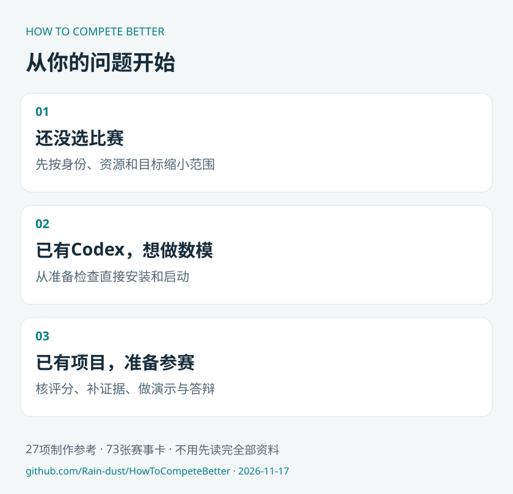
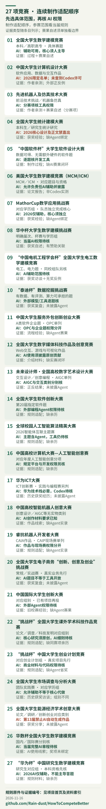

# 高性价比大学生竞赛指南

**先选比赛，再用 Agent 做出完整作品。**

[📖 PDF 在线预览](guide.pdf) · [⬇️ 下载 PDF](https://github.com/Rain-dust/HowToCompeteBetter/raw/refs/heads/main/guide.pdf) · [完整排名图](assets/ranking.png)

[数模教程](docs/math-modeling.md) · [Modex：Windows 成品](docs/modex.md) · [Codex / Claude：MathModelAgent](docs/coding-agent.md) · [2024 国赛 B：运行记录](examples/cumcm2024b/README.md)

**本轮实测：** Codex + 固定技能链完成2024国赛B四问、17页论文、代码与图表，干净环境可复现；有额度中断恢复和验收修正。[成果包](examples/cumcm2024b/README.md)

## 先看前五

| 排名 | 比赛与优先方向 | 直接用什么 | 先看这一句 |
| :--: | --- | --- | --- |
| 1 | **全国大学生数学建模竞赛** | [Modex教程](docs/modex.md) / [MathModelAgent](https://github.com/jihe520/MathModelAgent) | 给完整题面与附件；[看真实成果](examples/cumcm2024b/README.md) |
| 2 | **中国大学生计算机设计大赛** · 软件/数据/交互 | [界面与测试技能](https://github.com/anthropics/skills) | 2026限定工具名单，未查到Codex许可 |
| 3 | **先进机器人及仿真技术大赛** · 前沿技术/纯仿真 | Codex + [作品开发技能](https://github.com/anthropics/skills) | 先定具体赛项；硬件竞技另算成本 |
| 4 | **全国大学生统计建模大赛** | [统计分析技能](https://github.com/K-Dense-AI/scientific-agent-skills) | 数据流程适配；2026核心设计与正文禁直出 |
| 5 | **“中国软件杯”大学生软件设计大赛** · 纯软件题 | Codex + [开发与测试技能](https://github.com/anthropics/skills) | 选数据可得、无额外硬件的题 |

按**制作适配与已读反馈**排序，工具权限按当届赛项核。计设历史省奖不覆盖新规则；RST前沿技术与机器鱼仿真分别记证据。

[前五安装与开打指令](docs/top5-start.md) · [具体赛道与官方规则](docs/competition-catalog.md) · [真实参赛反馈](docs/field-feedback.md)

<strong>前五名：展开复制安装和开打指令</strong>

### 1. 全国大学生数学建模竞赛

[Modex官方展示仓库](https://github.com/N-allpass/modex-mh-agent) · [MathModelAgent主选技能链](https://github.com/jihe520/MathModelAgent)

安装：

~~~text
请读取本仓库 docs/coding-agent.md，使用 scripts/setup_math_workspace.py 在独立目录安装固定版本 MathModelAgent 完整技能链及依赖。先预检，再等待 inputs/problem.pdf 与附件齐全后开跑。Modex路线另见 docs/modex.md。
~~~

开打：

~~~text
使用 $1start-mathmodel，完整处理 inputs/problem.pdf 与全部附件。偏好已给：Typst、国赛中文、问数按题面，不重复确认。连续完成建模、实际计算、图表、论文和验收；所有数字来自真实运行，缺失样本不伪造。完整重跑并编译PDF、逐页查看，交付代码、结果、图表、paper/main.pdf与验收清单。
~~~

### 2. 中国大学生计算机设计大赛

[界面与浏览器测试技能](https://github.com/anthropics/skills) · [可选视频制作](https://github.com/remotion-dev/skills)

安装：

~~~text
请从 https://github.com/anthropics/skills 将 skills/frontend-design 和 skills/webapp-testing 两个完整目录安装到当前项目 .agents/skills/。保留脚本和资源，按 SKILL.md 建隔离依赖并配置 Playwright 浏览器。已有技能先核对并复用。用最小网页做一次主流程测试，报告安装路径、commit、实际截图与缺失依赖。安装后在此项目重开会话或确认技能已被发现。
~~~

开打：

~~~text
我要做中国大学生计算机设计大赛软件作品。inputs/ 有当届规程、赛道要求和真实需求。先输出工具权限与评分项对照表：2026规程限制AI工具范围，不能默认Codex在名单内。用于赛前练习，或确认当前参赛范围允许后，用 $frontend-design 完成一个单一核心功能的可运行系统；用 $webapp-testing 测正常、空输入和异常场景。交付实际运行视频、源码、部署说明和过程材料；演示必须来自同一版本，别只做PPT。
~~~

### 3. 先进机器人及仿真技术大赛

[创新软件作品可用技能](https://github.com/anthropics/skills) · [可替代Codex的独立编程agent：Cline](https://github.com/cline/cline)

安装：

~~~text
请从 https://github.com/anthropics/skills 将 skills/frontend-design 和 skills/webapp-testing 两个完整目录安装到当前项目 .agents/skills/。保留脚本和资源，按 SKILL.md 建隔离依赖并配置 Playwright 浏览器。已有技能先核对并复用。用最小网页做一次主流程测试，报告安装路径、commit、实际截图与缺失依赖。安装后在此项目重开会话或确认技能已被发现。 RST仿真项目另按 inputs/ 的官方平台与SDK说明配置编译器、依赖和启动命令，先编译并运行官方基线，保存版本和截图。Cline是另一套独立agent，无需安装到Codex技能目录。
~~~

开打：

~~~text
我要参加RST，具体届次、赛道、组别、官方规则和平台SDK已放 inputs/。先识别这是创新创业作品还是仿真竞技，不能混用评审方式。创新作品：完成一个能运行并按评分点演示的小产品；仿真：先跑官方基线、记录多次成绩，再逐项改策略，输出同环境的对照、失败回放和日志。按我的具体组别整理源码、说明、视频与答辩。官方基线未跑通前先修环境，不虚构成绩。
~~~

### 4. 全国大学生统计建模大赛

[Scientific Agent Skills](https://github.com/K-Dense-AI/scientific-agent-skills) · [统计分析入口](https://github.com/K-Dense-AI/scientific-agent-skills/tree/main/skills/statistical-analysis) · [数据检查入口](https://github.com/K-Dense-AI/scientific-agent-skills/tree/main/skills/exploratory-data-analysis)

安装：

~~~text
请从 https://github.com/K-Dense-AI/scientific-agent-skills 安装 skills/exploratory-data-analysis 与 skills/statistical-analysis 两个完整目录到当前项目 .agents/skills/，连同引用资源一起保留。按各 SKILL.md 配置独立 Python 环境，不安装无关科学栈。用本地合成CSV完成一次有缺失值、重复和分组信息的检查，报告环境、commit与结果。此安装用于赛前练习，不代表获准生成正式参赛核心内容。
~~~

开打：

~~~text
请先读 inputs/ 的全国大学生统计建模大赛当届AI规范。2026正式赛模式只执行规则明确允许的文献检索整理、语言格式校对等环节；不要直接生成研究选题、假设、框架、调查方案或论文正文。把拟执行的数据与代码任务单独列出待核权限。赛前练习模式下，可用 $exploratory-data-analysis 和 $statistical-analysis 对合成/历史练习数据做审计、按已给方案复现与诊断，输出可重跑代码和错误记录。正式提交内容以获准范围和人工原创方案为准。
~~~

### 5. “中国软件杯”大学生软件设计大赛

[开发与测试技能](https://github.com/anthropics/skills) · [可选演示视频技能](https://github.com/remotion-dev/skills)

安装：

~~~text
请从 https://github.com/anthropics/skills 将 skills/frontend-design 和 skills/webapp-testing 两个完整目录安装到当前项目 .agents/skills/。保留脚本和资源，按 SKILL.md 建隔离依赖并配置 Playwright 浏览器。已有技能先核对并复用。用最小网页做一次主流程测试，报告安装路径、commit、实际截图与缺失依赖。安装后在此项目重开会话或确认技能已被发现。
~~~

开打：

~~~text
我要参加中国软件杯。inputs/ 有当届题目、评分标准、规定技术栈、工具条款与原始数据。先把每个评分点写成可操作验收动作，确认数据、接口和硬件可得，再做最小端到端系统。用 $frontend-design 打磨界面，用 $webapp-testing 验证Web评分动作与异常输入；原生部分另用对应测试工具。先修稳定性再加功能，最后交源码、环境锁定、部署说明、同版本演示视频和答辩问答，保留AI开发记录。
~~~

<strong>完整连续排名 1–27（同一顺序，不分档）</strong>

| 排名 | 比赛 | 一句话选法 |
| :--: | --- | --- |
| 1 | **全国大学生数学建模竞赛** | 先跑通模型，再写论文；辅助可用，核心须人主导 |
| 2 | **中国大学生计算机设计大赛** | 优先软件、数据与交互作品；2026限定名单；未查到Codex许可 |
| 3 | **先进机器人及仿真技术大赛** | 先选前沿技术挑战或纯仿真；分赛项核工具权限 |
| 4 | **全国大学生统计建模大赛** | 数据流程很配，正式赛权限收紧；2026核心设计及正文禁直出 |
| 5 | **“中国软件杯”大学生软件设计大赛** | 优先数据已给、能本机跑的题；逐题核开发工具 |
| 6 | **美国大学生数学建模竞赛（MCM/ICM）** | 现成Agent链最完整之一；允许负责任AI辅助并披露 |
| 7 | **MathorCup数学应用挑战赛** | 2026仅限AI辅助；核心建模与求解须独立完成 |
| 8 | **华中杯大学生数学建模挑战赛** | 有Codex获奖自述，证据带折扣；当届AI权限待核 |
| 9 | **“中国电机工程学会杯”全国大学生电工数学建模竞赛** | 通用数模链能迁移；AI辅助范围待核 |
| 10 | **“泰迪杯”数据挖掘挑战赛** | 适合把数据项目做扎实；外部模型/工具逐题核 |
| 11 | **中国大学生服务外包创新创业大赛** | 有真实需求再上，软件题优先；OPC与企业题权限分开 |
| 12 | **全国大学生数字媒体科技作品及创意竞赛** | Web/游戏适配，先补真实赛果；AI使用须披露原创贡献 |
| 13 | **未来设计师·全国高校数字艺术设计大赛** | 创意编程可试，审美仍是门槛；AIGC与交互类别分别核 |
| 14 | **全国大学生软件创新大赛** | 软件制作很配，口碑证据待补；外部编程Agent权限待核 |
| 15 | **全球校园人工智能算法精英大赛** | 只有合适主题才值得投；主题含Agent，工具仍待核 |
| 16 | **中国高校计算机大赛—人工智能创意赛** | 有现成项目更划算；规定平台与开发权限另核 |
| 17 | **华为ICT大赛** | 软件创新题可看，生态成本另算；华为技术栈必需，Codex待核 |
| 18 | **中国高校智能机器人创意大赛** | 只考虑无需自购硬件的类别；AI创作材料要求已知 |
| 19 | **睿抗机器人开发者大赛** | 先筛纯软件/仿真项；作品与现场赛权限分开 |
| 20 | **全国大学生电子商务“创新、创意及创业”挑战赛** | 已有真实业务时再复用；AI题目不等于工具开放 |
| 21 | **中国国际大学生创新大赛** | 已有产品与数据更合适；外部Agent权限待核 |
| 22 | **“挑战杯”全国大学生课外学术科技作品竞赛** | 有研究积累再投；核心研究须原创，AI细则待核 |
| 23 | **“挑战杯”中国大学生创业计划竞赛** | 有真实创业项目再投；商业材料与代码权限待核 |
| 24 | **全国大学生市场调查与分析大赛** | 分析适配，拿样本最费人；允许辅助不等于核心代做 |
| 25 | **全国大学生能源经济学术创意大赛** | 第13届禁止AI自动生成作品参赛 |
| 26 | **华数杯全国大学生数学建模竞赛** | 方法可迁移，本轮结果证据较薄；当届完整AI章程待核 |
| 27 | **“华为杯”中国研究生数学建模竞赛** | 本科生先核资格，不能默认报名；2026AI仅辅助，不能主导答题 |

[逐项赛道、证据、当届规则和报名入口 →](docs/competition-catalog.md)

## 数模从这里开始

- **先看[总教程](docs/math-modeling.md)**：准备题面、附件与规则，再按环境、建模、求解、验证和成果包推进。
- **用 Windows 成品：[Modex 路线](docs/modex.md)**。Modex 是闭源 Windows 应用，上游 GitHub 用于展示；安装与使用按官方步骤。
- **用编程 agent：[Codex / Claude 路线](docs/coding-agent.md)**。首选 MathModelAgent 的一套 skills 链，具体入口、依赖与验收见教程。
- **看[2024 国赛 B 示例](examples/cumcm2024b/README.md)**：《生产过程中的决策问题》的运行记录见示例。历史题演示、工具实测和比赛获奖分别说明。

## PDF 预览与整包下载

[在线阅读 26 页指南](guide.pdf) · [直接下载 PDF](https://github.com/Rain-dust/HowToCompeteBetter/raw/refs/heads/main/guide.pdf) · [版本与整包下载](https://github.com/Rain-dust/HowToCompeteBetter/releases/latest)

## 证据与资料

现有反馈样本截至 **2026-11-16**：75 篇原帖详情（小红书 45、贴吧 30），其中 74 篇有非空文字正文；270 条去重小红书评论、121 条贴吧楼层记录。16 篇亲历／个人经验材料用于路线判断，另有 22 份既有外部材料。评论不作为独立成功案例。

作者的数模系列、计设及第十八届 RST 前沿技术挑战组省奖经历单列为 **U01 亲历自述**。外部奖项、身份与证书真伪未独立核验；成功、失败、返工和未获奖的制作过程均保留。

[原帖解读、编号与研究方法](docs/field-feedback.md) · [75 条分类数据](data/social-feedback.json) · [22 份外部材料](data/feedback-records.json) · [排名与权限数据](data/ranking.json) · [赛事来源索引](docs/sources.md) · [67 条选赛参考](docs/competition-catalog.md)

## 分享与离线阅读

[四入口展示图](assets/overview.svg) · [连续 27 项排名长图](assets/ranking.svg) · [PDF 资料](guide.pdf) · [下载 PDF](https://github.com/Rain-dust/HowToCompeteBetter/raw/refs/heads/main/guide.pdf)

预览可分享展示图（SVG，可放大）

[提交你的参赛经历](https://github.com/Rain-dust/HowToCompeteBetter/issues/new?template=experience.yml) · [纠错或补充规则](https://github.com/Rain-dust/HowToCompeteBetter/issues/new?template=correction.yml) · [贡献方式](CONTRIBUTING.md)

页面与展示图更新：**2026-11-16**。逐项规则的核对日期与原件见[排名数据](data/ranking.json)；当届报名、资格、AI 工具与提交范围以官方通知为准。旧版 PDF 的更新状态见文件本身。

全国性赛事、证书奖级、学校认定分别核对。工时预算属于估算，公开反馈不能推出获奖率。结构与命名灵感来自[高性价比人生指南](https://github.com/eternity4719/HowToLiveBetter)，本项目独立整理竞赛与反馈资料。
