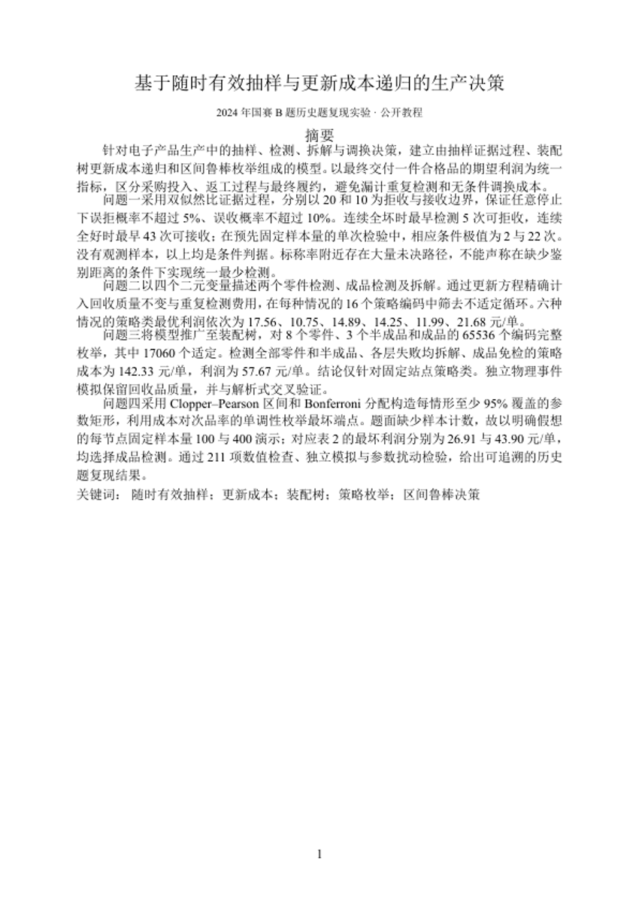

# 2024 国赛 B：真实运行记录与成果包

**历史题复现实验，不是获奖作品。** 题目为《生产过程中的决策问题》，使用 Codex + MathModelAgent 固定技能链，计算与论文成果保存在本目录。[回数模教程](../../docs/math-modeling.md)

[查看论文 PDF](paper/main.pdf) · [下载整个示例 ZIP](../cumcm2024b-example.zip) · [机器运行摘要](run-summary.json) · [独立审计](audit/audit-review.json)

## 实际做了什么

一次完整启动任务要求读取题面，连续完成四问建模、计算、图表与论文。首次执行在计算完成后因 workspace credits 中断；恢复同一会话继续写图表与论文。终验时又修正了公式排版、图例和孤页。它是可恢复的真实流程，不是无中断的一次成功演示。

- 模型：Codex CLI 0.167.0-alpha.3.2，gpt-6.1-sol，xhigh；复用已有 ChatGPT 登录。
- 技能：[jihe520/MathModelAgent](https://github.com/jihe520/MathModelAgent)，固定 `03f4eb388b3862b7bde55b508dceaf3d6b39d5ac`；只用skills链。
- 环境：Windows 10 build19045、Python3.12.10、Typst0.15.1，直接依赖见requirements.txt。
- Modex不在本次运行中；另有[官方步骤教程](../../docs/modex.md)。Claude兼容安装说明也不代表本轮实跑过Claude。
- 原题：[官方年度发布页](https://dxs.moe.gov.cn/zx/a/hd_sxjm_sthb/240605/1887443.shtml) / [两页题面镜像](https://jichu.greathiit.com/uploadfile/2024/1015/20241015214235830.pdf)。输入PDF SHA256：`f54529dd15d729b046e248ea41033b4f66ef68333be2bee912b0c54eafd227ab`。

原题PDF、上游技能、原始模型会话与凭据未打包。`inputs/parameters.json`是原题数值表的转录，可直接复现计算，无需重新调用模型。

## 快速核对结果

第二问策略位依次为“零件1检测、零件2检测、成品检测、拆解”。1为是，0为否；金额为每最终交付一个合格品的元/单。

| 情况 | 策略 | 成本 | 利润 |
| --- | --- | ---: | ---: |
| 1 | 1101 | 38.44444444 | 17.55555556 |
| 2 | 1101 | 45.25000000 | 10.75000000 |
| 3 | 1101 | 41.11111111 | 14.88888889 |
| 4 | 1111 | 41.75000000 | 14.25000000 |
| 5 | 0100 | 44.01234568 | 11.98765432 |
| 6 | 0000 | 34.32132964 | 21.67867036 |

第三问枚举65,536种编码，17,060种适定；类内最优ID49151，策略1111111111111101，成本142.33333333，利润57.66666667。

**这些最优值限定于固定工位决策、拆回子件送原工位复检。** 若允许已知良品免复检，第二问情况1可改善到37.88888889；当前结果不是更大自适应策略空间的全局最优。

第一问在次品率恰为10%、最多抽2000次时，方案仍有86.407%的未决率。题目没有给真实样本，不能宣称对实际批次已判接收/拒收。第四问所有n=100/400计数均为假想固定样本演示，95%覆盖按单个生产目标内节点联合解释，不是全部14行同时95%。

## 复现计算

进入本目录，在新的 Python 3.12 环境执行：

~~~text
python -m venv .venv
.venv/Scripts/python.exe -m pip install -r requirements.txt
.venv/Scripts/python.exe code/run_all.py
.venv/Scripts/python.exe audit/review_solution.py
~~~

以上是Windows命令；其他系统解释器路径为`.venv/bin/python`，本轮未端到端验证。脚本会重算四问、模拟、灵敏度和图表，并自动采集复现环境。固定随机种子，完整策略表在results/。

无需模型、密钥或联网取数；只有首次安装依赖需要网络。普通浮点差异按审计容差判断，不能要求模拟结果在不同库版本上逐字节相同。

## 编译论文

先安装官方Typst0.15.1，再从本目录执行：

~~~text
typst compile --root . paper/main.typ paper/main.pdf
~~~

需要本机可用的中文字体。当前模板使用宋体、黑体、楷体与Times New Roman；若在其他系统，改为当地可用字体并重新逐页检查。示例保留了便于学习的目录，正式参赛须按当届格式另核，不能把练习PDF直接当提交包。

## 验收证据

模型生成实现的211项自检与独立重写的242项审计分别记账；独立审计不导入求解模块，覆盖全部策略、概率边界和事件模拟。最终完成状态、页数、实际运行时间与产物hash见[run-summary.json](run-summary.json)和[发布清单](artifact-manifest.json)。

公开打包后做了可移植性整理：自动生成环境元数据；补齐独立审计的oracle输入与生成脚本；移出依赖原始工作区的辅助检查脚本，并将检查命令路径改成可移植写法。没有更改数值求解公式。故本目录是经过复现整理的成果包，不冒称原始工作区逐字节镜像。

## 费用和限制

使用已有ChatGPT登录及模型额度，首次确实遇到额度耗尽。未取得单次实付账单，因此费用记为不可分摊，不写免费。实际计算耗时和模型会话耗时分开看；排版、环境、独立审计及打包也占时间。

参考排版来自上游技能模板，遵循其[使用限制](https://github.com/jihe520/MathModelAgent/blob/03f4eb388b3862b7bde55b508dceaf3d6b39d5ac/docs/md/License.md)。[来源与范围说明](../../docs/credits.md)。
